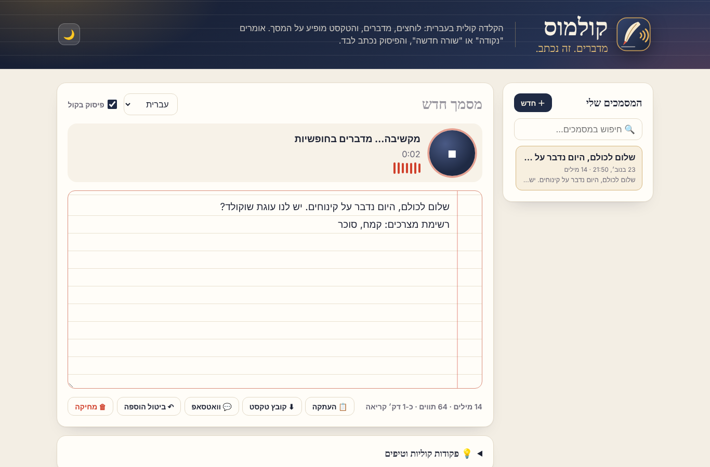
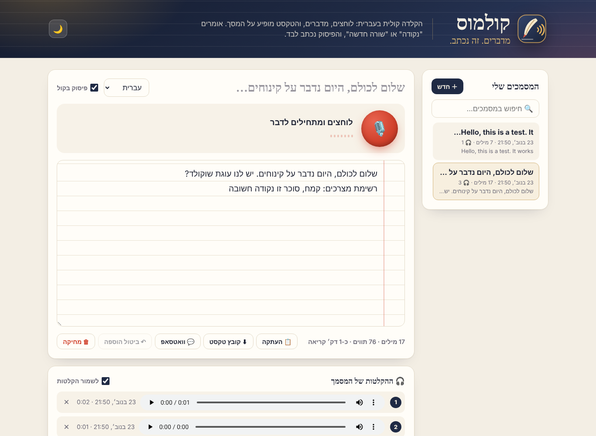
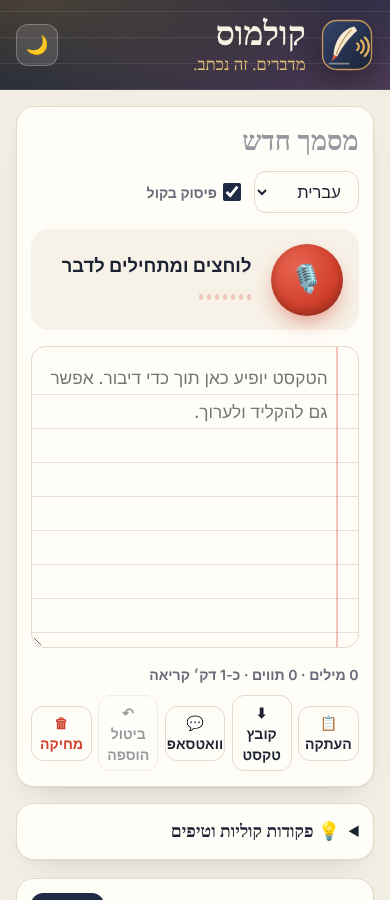

<div align="center">


# קולמוס · Kulmus

### מדברים. זה נכתב.
*Speak, and it's written.*

Hebrew dictation in the browser. Press record, talk, and the text appears on the page as you speak. Say "נקודה", "פסיק" or "שורה חדשה" and the punctuation is written for you. Notes are saved automatically, together with the recordings.




</div>

## ✨ Features

- **🎙️ Live dictation in Hebrew, English and Arabic.** Words appear as you speak: grey while the browser is still guessing, then final once a sentence ends. Recording keeps going through pauses until you press stop (or Space).
- **🗣️ Punctuation by voice:** נקודה · פסיק · סימן שאלה · סימן קריאה · נקודתיים · שורה חדשה · פסקה חדשה · פתח/סגור סוגריים… (and the English and Arabic equivalents). Commands only match whole words, so "פסיקה" stays a word. They can be turned off.
- **✍️ Dictate anywhere:** click inside the text and the next recording is inserted at the cursor, with tidy spacing. **↶ Undo** removes the last dictated chunk.
- **📄 Notes:** automatic saving, titles generated from the first words, search across all notes (ignoring niqqud), and word and character counts.
- **🎧 The recordings themselves** are saved next to the text (MediaRecorder + IndexedDB), so you can listen again and check what was said.
- **Export:** copy, download a `.txt` file, or send to WhatsApp.
- **Installable (PWA)**, dark mode, responsive, and a ruled-notebook look.
- **Private:** notes and recordings stay in your browser.

<p align="center"> </p>

## 🧱 Architecture

```
kulmus/
├── index.html           # markup, inline SVG logo
├── styles.css           # ink & paper theme, ruled paper, recording animations
├── app.js               # speech recognition loop, audio recording, notes UI, export
├── logic.js             # pure text logic: voice commands → punctuation, spacing, caret insert, search  ← tested
├── store.js             # localStorage for notes, IndexedDB for audio clips
├── logic.test.js        # 9 tests (node --test)
├── manifest.webmanifest # PWA
└── sw.js                # offline app shell
```

**Interesting bits**
- **Never-ending listening:** browsers stop recognition after a pause or about a minute, so `onend` restarts it for as long as the user hasn't pressed stop.
- **Punctuation that reads naturally:** commands are swapped for placeholder tokens first, then the spacing is fixed per mark type. Closing marks attach to the previous word, opening brackets to the next one, and line breaks swallow the spaces around them.
- **Dictating into the middle of a text:** pressing the button moves focus away from the textarea, so the last caret position is tracked on click, keyup and select, and the chunk is inserted there with smart spacing.
- **Tested without a microphone:** the end-to-end tests replace `SpeechRecognition` with a scripted fake engine and use Chromium's fake audio device.

## ⚠️ Browser support
Speech recognition uses the browser's built-in service (Web Speech API): **Chrome, Edge and Safari** support it and it needs an internet connection. **Firefox** doesn't, and the app says so and still works as an editor. The microphone needs a secure page (https), which GitHub Pages provides.

## 🚀 Run
```bash
npm start   # or: python3 -m http.server   →  http://localhost:8000
npm test
```
Deploy to GitHub Pages: **Settings → Pages → Deploy from a branch → `main` / root**.

---
<div align="center">Built by <b>Racheli Arzon</b> 🖋️</div>
